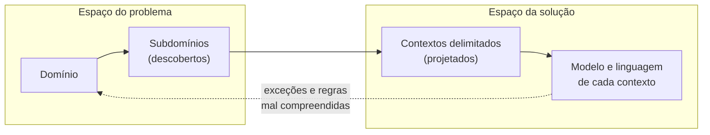
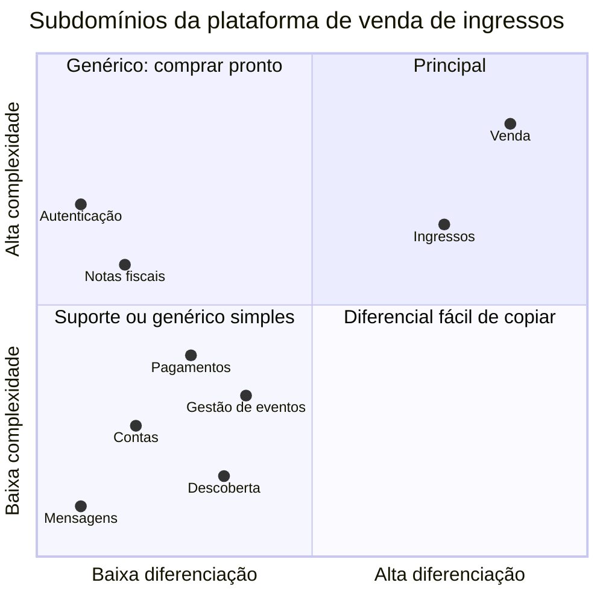

# Design Estratégico com DDD

Guia de referência rápida sobre **como entender um domínio complexo e dividi-lo antes de escrever código**: complexidade essencial, espaço do problema e espaço da solução, descoberta do domínio, subdomínios e sua classificação, destilação, modelo de domínio, contextos delimitados e linguagem ubíqua, com heurísticas de fronteira, um exercício resolvido e um exemplo aplicado.

> [!NOTE]
> Síntese pessoal de conceitos consolidados na literatura de *Domain-Driven Design*. As fontes estão nas [referências](#referências). Complementa os guias [Fundamentos de Arquitetura de Software](https://github.com/sidartaoss/fundamentos-arquitetura-software), [Monolitos e Microsserviços](https://github.com/sidartaoss/monolitos-e-microsservicos), [Práticas e Tecnologias para Microsserviços](https://github.com/sidartaoss/praticas-e-tecnologias-para-microsservicos), [Custos e Riscos de Microsserviços](https://github.com/sidartaoss/custos-e-riscos-de-microsservicos), [Adoção de Microsserviços](https://github.com/sidartaoss/adocao-de-microsservicos), [Comunicação entre Microsserviços](https://github.com/sidartaoss/comunicacao-entre-microsservicos), [Fronteiras de Microsserviços](https://github.com/sidartaoss/fronteiras-de-microsservicos) e [Implementação de Microsserviços](https://github.com/sidartaoss/implementacao-de-microsservicos).

## Em resumo

- **DDD ataca a complexidade do negócio, e não a da tecnologia.** O design do software é guiado por um modelo do domínio, construído com quem conhece o negócio e expresso em uma linguagem compartilhada.
- **O problema vem antes da solução.** Subdomínios existem no negócio e são descobertos; contextos delimitados são decisões de design.
- **O investimento segue a estratégia.** Subdomínios principais recebem os profissionais mais experientes; os de suporte, soluções simples; os genéricos, soluções prontas. A destilação revela o que é principal em áreas que parecem secundárias.
- **Um modelo só é consistente dentro de um contexto.** Um modelo único para toda a empresa degenera em uma grande bola de lama; cada contexto delimitado tem modelo e linguagem ubíqua próprios.
- **A linguagem é a principal pista de fronteira.** Um termo com dois sentidos, dois termos para a mesma coisa ou uma entidade disputada por áreas diferentes indicam contextos distintos.
- **DDD tem custo.** Compensa em domínios complexos e exige acesso aos especialistas; o design estratégico tem valor mesmo sem o tático.

## 1. Domínio, complexidade e DDD

> "O coração do software é sua capacidade de resolver problemas do domínio para o seu usuário." — Eric Evans

**Domínio** é a área de conhecimento ou de atividade à qual o software se aplica: o negócio como ele funciona, com seus conceitos, regras e processos, exista ou não um sistema. Não se confunde com as classes que o representam, e uma mesma empresa pode atuar em mais de um domínio. Fred Brooks separou as dificuldades do software em essenciais, inerentes ao problema, e acidentais, ligadas à forma de construí-lo:

| | Complexidade essencial | Complexidade acidental |
|---|---|---|
| Origem | O próprio negócio: regras, exceções e processos | As escolhas de construção: frameworks, infraestrutura, código legado |
| Tratamento | Não se elimina; organiza-se | Reduz-se com melhores ferramentas e decisões |
| Exemplo: venda de ingressos | A meia-entrada limitada a 40% dos ingressos de cada evento; um assento, um comprador | Um mapeamento objeto-relacional que gera consultas lentas no mapa de assentos |

Quando a complexidade essencial não é organizada, ela se espalha pelo código e alimenta a acidental. Eric Evans reuniu em *Domain-Driven Design* (2003) princípios e padrões para atacá-la: entender profundamente o domínio, com os especialistas, e guiar o design por um modelo desse domínio, expresso em uma linguagem compartilhada. DDD é uma abordagem, e não uma metodologia, uma arquitetura ou uma estrutura de pacotes: não prescreve passos, convive com qualquer processo de desenvolvimento e estilo arquitetural, e seus padrões são ferramentas, e não obrigações.

| | Design estratégico | Design tático |
|---|---|---|
| Pergunta | Que partes tem o negócio, onde investir e onde cada modelo vale? | Como expressar o modelo em código? |
| Ferramentas | Subdomínios, classificação, destilação, contextos delimitados, linguagem ubíqua, mapa de contextos | Entidades, objetos de valor, agregados, eventos de domínio, repositórios, serviços de domínio |
| Quando | Primeiro: decide onde o tático compensa | Dentro de cada contexto, sobretudo nos subdomínios principais |

## 2. Espaço do problema e espaço da solução

Vaughn Vernon descreve o domínio em dois espaços. Misturá-los leva a programar sobre suposições: inventar regras que o negócio não tem e ignorar as que ele tem.

| | Espaço do problema | Espaço da solução |
|---|---|---|
| O que é | O negócio como funciona, com ou sem software | Como o software atende ao negócio |
| Elementos | Domínio, subdomínios, especialistas, regras e processos | Modelos de domínio, contextos delimitados, arquitetura e código |
| Atitude | Investigar e descobrir; nada se inventa | Projetar e decidir, com trade-offs |
| Exemplo: venda de ingressos | A bilheteria aplica a cota de meia-entrada, com ou sem sistema | Em que contexto a cota vive, quando é verificada e com que consistência |



Os dois espaços se alimentam: implementar uma regra costuma revelar exceções que ninguém mencionou, e a resposta está de volta no problema, com os especialistas. Nem tudo do problema vira software: há processos que continuam manuais ou são atendidos por produtos de mercado.

## 3. Descoberta do domínio

**Especialistas do domínio** são as pessoas que conhecem o negócio por vivê-lo: operadores, gestores, analistas. Nenhum deles conhece tudo, e o conhecimento de cada um é, em boa parte, implícito: regras que nunca foram escritas e exceções lembradas apenas diante de um caso concreto. A descoberta do domínio torna esse conhecimento explícito e produz um **modelo mental compartilhado** entre especialistas e desenvolvedores; Evans chama esse trabalho contínuo de *knowledge crunching*.

| Obstáculo | Prática |
|---|---|
| Desenvolvedores falam de tabelas e APIs; especialistas, de regras e casos | Conversar na linguagem do negócio, com exemplos concretos, e deixar a tecnologia para depois |
| Os primeiros requisitos parecem suficientes | Explorar exceções e casos-limite: o que acontece quando o evento é adiado? E quando o titular do ingresso não é quem o comprou? |
| O conhecimento está na cabeça de poucas pessoas | Registrar glossários, esboços e exemplos, e revisá-los com os especialistas |
| Cada área conhece só a sua parte do processo | Reunir as áreas em workshops como o *EventStorming*, de Alberto Brandolini, ou o *Domain Storytelling*, de Stefan Hofer e Henning Schwentner |

O especialista também ganha: ao explicar o negócio, encontra inconsistências e oportunidades de melhoria nos próprios processos.

## 4. Subdomínios

Um **subdomínio** é uma parte do domínio com objetivos, regras e, muitas vezes, linguagem próprios. Vlad Khononov acrescenta uma visão técnica: um conjunto de casos de uso coerentes, que costumam envolver o mesmo ator e manipular dados intimamente relacionados. Domínio e subdomínio são termos relativos: visto de perto, um subdomínio pode revelar subdivisões, e dividir só faz sentido enquanto aumenta a clareza.

Subdomínios não se inventam: estão no negócio e são encontrados por sinais.

| Grupo | Sinal | Exemplo: venda de ingressos |
|---|---|---|
| Organização | Áreas, especialistas e trocas formais entre equipes; ponto de partida, e não regra, porque uma área pode abrigar mais de um subdomínio | A operação de eventos cuida da programação das sessões e da portaria no dia do evento: objetivos, ritmos e especialistas diferentes |
| Linguagem | O mesmo termo com sentidos diferentes | "Ingresso" é item de um pedido para a venda e credencial de entrada para a portaria |
| Linguagem | Termos diferentes para a mesma coisa | A empresa que organiza o show é "produtor" para a operação e "cliente" para a equipe comercial |
| Linguagem | Termos que precisam de qualificador | "Cancelamento da compra", pedido pelo comprador, e "cancelamento do evento", decidido pelo produtor, seguem regras diferentes |
| Regras | O mesmo fato com regras diferentes | Um evento adiado muda a data e o mapa na programação, revalida as credenciais na portaria e adia o repasse ao produtor |

A identificação é, ao mesmo tempo, exploratória e decisória: times diferentes podem chegar a divisões um pouco diferentes, e o que importa são critérios explícitos, validados com o negócio. Capacidades de negócio são um bom ponto de partida; os subdomínios acrescentam a linguagem, a complexidade das regras e a importância estratégica ([fronteiras](https://github.com/sidartaoss/fronteiras-de-microsservicos#4-capacidades-de-negócio-e-subdomínios)).

## 5. Classificação: principal, de suporte e genérico

Nem toda parte do negócio merece o mesmo investimento. A classificação é uma decisão estratégica, do negócio; o papel do time técnico é descobri-la com os especialistas.

| Tipo | Papel | Complexidade | Ritmo de mudança | Estratégia usual |
|---|---|---|---|---|
| Principal (*core*) | Diferencial competitivo: o motivo pelo qual os clientes escolhem a empresa | Em geral alta | Alto | Desenvolvimento interno, com os profissionais mais experientes e dedicados |
| De suporte (*supporting*) | Necessário ao negócio, sem diferenciá-lo | Baixa | Baixo | Desenvolvimento interno com design simples, terceirização ou reaproveitamento |
| Genérico (*generic*) | Resolvido do mesmo jeito por todas as empresas | Pode ser alta, mas já está resolvida | Baixo | Comprar, contratar como serviço ou adotar *open source* |

A comparação segue Vlad Khononov; Evans nomeou o *core domain* e os *generic subdomains*, e Vernon consolidou o subdomínio de suporte. Quatro cuidados:

- **Principal não é sinônimo de complexo.** Processar pagamentos com cartão é complexo e, ainda assim, genérico para quem vende ingressos.
- **Poucos principais.** Uma empresa pode ter mais de um, mas cada um a mais dilui o foco dos melhores profissionais.
- **A classificação muda com a estratégia.** Uma fila virtual contratada como serviço é genérica; se a empresa decide competir pela venda justa em eventos de alta procura, com pré-cadastro e sorteio do direito de compra, ela se torna principal. O caminho inverso também ocorre: diferenciais viram *commodity*.
- **Nem todo subdomínio vira software.** Um subdomínio principal pode ser, em grande parte, trabalho humano, apoiado por ferramentas simples (seção 11).

O ***Core Domain Chart***, proposto por Nick Tune e publicado pela DDD Crew, posiciona cada subdomínio em dois eixos, diferenciação do negócio e complexidade do modelo, e torna a classificação discutível com o negócio. A seção 12 aplica o gráfico à plataforma de venda de ingressos.

## 6. Destilação

> "Destilação é o processo de separar os componentes de uma mistura para extrair a essência em uma forma que a torne mais valiosa e útil." — Eric Evans

Uma primeira decomposição, de granularidade grossa, tende a classificar áreas inteiras como de suporte ou genéricas e a esconder o que nelas é essencial. No DDD, a **destilação** separa o núcleo do restante, para torná-lo visível e concentrar nele o investimento. A pergunta que orienta: dentro desta área que parece secundária, há algo que decide por que os clientes escolhem a empresa? Se houver, essa parte é extraída como subdomínio principal, e o restante mantém a classificação original.

Evans descreve ferramentas para isso, como a ***Domain Vision Statement***, uma página que descreve o núcleo e o valor que ele traz; o ***Highlighted Core***, que o torna evidente no modelo e na documentação; e o ***Segregated Core***, que o separa do código de suporte. Destila-se até onde a separação traz clareza estratégica; além disso, apenas se fragmenta.

## 7. Modelo de domínio e a grande bola de lama

O **modelo de domínio** é uma abstração seletiva do domínio, no espaço da solução: representa os conceitos, as regras e os comportamentos que importam para o problema, e não o mundo inteiro. Pode ser expresso em conversas, diagramas e código, mas não se confunde com nenhum deles, nem com uma camada da arquitetura. No código, o modelo concentra as regras em um só lugar e fala a língua do negócio:

```java
// Contexto de ingressos: o ingresso como credencial de entrada
public class Ingresso {

    private Titular titular;
    private SituacaoDoIngresso situacao;
    private int transferencias;

    public void transferirPara(Titular novoTitular, Instant agora, Instant aberturaDosPortoes) {
        if (situacao != SituacaoDoIngresso.VALIDO) {
            throw new IngressoInvalido(situacao);
        }
        if (transferencias > 0) {
            throw new TransferenciaRecusada("Um ingresso só pode ser transferido uma vez");
        }
        if (agora.isAfter(aberturaDosPortoes.minus(Duration.ofHours(2)))) {
            throw new TransferenciaRecusada("Transferências encerram duas horas antes da abertura dos portões");
        }
        this.titular = novoTitular;
        this.transferencias++;
    }
}
```

A **grande bola de lama** (*Big Ball of Mud*), descrita por Brian Foote e Joseph Yoder em 1997, é o sistema estruturado ao acaso, cuja organização resulta mais de remendos convenientes do que de design. Em modelos de domínio, ela nasce quando um único modelo tenta servir à empresa inteira. Uma classe `Ingresso` compartilhada pela venda, pela portaria, pelo repasse e pelo atendimento acumula lote, tipo e preço, titular e QR code, valor devido ao produtor e motivo do chamado, além de uma situação que mistura "pago", "transferido", "utilizado" e "repassado". Cada área passa a depender de atributos e validações das outras, qualquer mudança exige coordenar todos os times, e as regras se perdem em condicionais. O problema é semântico antes de ser técnico: o mesmo termo significa coisas diferentes para cada área.

## 8. Contextos delimitados e linguagem ubíqua

> "Subdomínios são descobertos; contextos delimitados são projetados." — Vlad Khononov

Evans define contexto como o cenário em que uma palavra ou afirmação aparece e que determina o seu significado. Um **contexto delimitado** (*bounded context*) torna esse cenário explícito no software: é a fronteira, no espaço da solução, dentro da qual um modelo é consistente e cada termo tem um único significado. Para Martin Fowler, é um padrão central do DDD e o foco do design estratégico; seu exemplo é o de uma empresa de energia em que a palavra *medidor* tinha significados sutilmente diferentes para áreas diferentes. Fora da fronteira, o mesmo termo pode, e muitas vezes deve, significar outra coisa.

A **linguagem ubíqua** é a linguagem de cada contexto, construída com os especialistas e usada sem tradução nas conversas, na documentação, nos testes e no código. Nasce do negócio, e não da tecnologia: se a portaria fala em transferir o ingresso para outro titular, o código tem `transferirPara(novoTitular)`, e não `alterarDono`. Ela evolui com o domínio, e cada mudança na linguagem é uma mudança no modelo.

A relação entre subdomínios e contextos é uma decisão de design:

| Situação | Quando ocorre |
|---|---|
| Um contexto por subdomínio | Ponto de partida mais comum |
| Um subdomínio, vários contextos | O subdomínio reúne modelos com linguagens diferentes |
| Um contexto, vários subdomínios | Subdomínios pequenos e muito relacionados, mantidos pelo mesmo time |
| Um subdomínio sem contexto | O subdomínio continua manual ou é atendido por um produto de mercado |

Da fronteira semântica decorrem as demais: cada contexto pertence a um único time, que pode cuidar de mais de um, e tem código e dados próprios, em um módulo, em um serviço ou em vários. Um serviço por contexto é um bom começo em microsserviços, mas a relação não é obrigatória: um contexto pode ser um módulo de um [monolito modular](https://github.com/sidartaoss/adocao-de-microsservicos#2-monolito-modular) ou se dividir em vários serviços por requisitos não funcionais. Serviços puramente técnicos, como o envio de mensagens, não têm modelo de domínio próprio e não são contextos. E separar implantações ou tecnologias é decisão de arquitetura: o contexto é uma fronteira de significado, e uma coisa não substitui a outra.

## 9. Heurísticas de fronteira

Não há fórmula para traçar contextos, mas há sinais. Os subdomínios são o ponto de partida, e os sinais abaixo indicam onde dividir ou unir:

| Heurística | Sinal de que há dois contextos |
|---|---|
| Linguagem | Termos homônimos com sentidos diferentes, sinônimos usados por áreas diferentes ou termos que só se entendem com um qualificador |
| Etapas do processo | No *EventStorming*, os eventos que dividem o fluxo do negócio em fases, que Alberto Brandolini chama de *pivotal events*, costumam marcar a passagem de um contexto a outro |
| Ritmo de mudança | Uma parte muda toda semana, e outra quase nunca |
| Entidade disputada | Casos de uso muito diferentes acrescentam atributos, situações e condicionais à mesma classe |
| Pessoas | Times que alteram os mesmos arquivos e se bloqueiam, ou áreas que quase não conversam forçadas a compartilhar um modelo; pela [Lei de Conway](https://github.com/sidartaoss/monolitos-e-microsservicos#3-a-lei-de-conway), o software tende a copiar a estrutura de comunicação da organização |

Heurísticas iluminam caminhos, mas não decidem sozinhas: a fronteira é refinada à medida que o domínio é mais bem compreendido, e não se espera acertá-la de primeira. Para documentar cada contexto, a DDD Crew publica o *Bounded Context Canvas*, que inspira o modelo resumido abaixo.

<details>
<summary><strong>Canvas mínimo de contexto delimitado</strong></summary>

```markdown
# Contexto: <nome>

- Propósito: que problema do negócio este contexto resolve?
- Classificação estratégica: principal | de suporte | genérico
- Subdomínios atendidos: ...
- Time responsável: ...

## Linguagem ubíqua
| Termo | Significado neste contexto |
|---|---|

## Regras e decisões de negócio
- ...

## Comunicação
- Recebe: comandos, consultas e eventos de outros contextos
- Envia: comandos, consultas e eventos para outros contextos

## Questões em aberto
- ...
```

</details>

## 10. Quando aplicar DDD

| Critério | A favor | Contra |
|---|---|---|
| Regras de negócio | Difíceis até de explicar, com muitas exceções, e mal compreendidas pelo time | Poucas e simples, como em um cadastro de casas de espetáculos |
| Acesso ao negócio | Especialistas disponíveis para explorar e validar o modelo | Especialistas inacessíveis ou sem tempo |
| Horizonte | Sistema de vida longa, que muda junto com o negócio | Sistema provisório, como o site de uma campanha |
| Disposição para modelar | Time e liderança dispostos a aprender e a investir em modelagem contínua | Expectativa de resultado imediato, sem espaço para aprender |

O custo é real: curva de aprendizado, tempo dos especialistas e alinhamento entre time, analistas e liderança. Por isso o investimento acompanha a classificação: Vlad Khononov propõe escolher o padrão de implementação pela complexidade da lógica de negócio, com um modelo de domínio onde ela é alta, em geral nos subdomínios principais, e *transaction script* ou *active record* onde é simples. O design estratégico tem valor mesmo sem o tático: mapear e classificar subdomínios e delimitar contextos orienta decisões também em sistemas legados.

## 11. Exercício: clube de assinatura de cafés especiais

Uma empresa vende assinaturas de cafés especiais. Sua equipe de provadores visita produtores, prova amostras e compra microlotes de alta pontuação, que a própria empresa torra em pequenas quantidades. Todo mês, cada assinante recebe dois pacotes escolhidos a partir das notas que deu aos cafés anteriores, sem repetir microlotes. Na assinatura de presente, quem paga não é quem recebe, e os cafés são escolhidos pelo paladar do presenteado. A empresa também mantém uma loja avulsa, cobra por cartão e PIX, emite notas fiscais, entrega por transportadoras e atende por chat. Seu diferencial declarado é unir curadoria e personalização: cafés raros que combinam com o paladar de cada assinante.

**Para resolver.** Quais são os subdomínios, e de que tipo é cada um? Há um subdomínio principal escondido em uma área que parece de suporte? Que termos mudam de sentido entre as áreas, e que contextos delimitados eles sugerem? O que mudaria se a empresa passasse a competir por preço?

<details>
<summary><strong>Uma proposta de solução</strong></summary>

| Subdomínio | Tipo | Estratégia |
|---|---|---|
| Curadoria: prova, pontuação e compra de microlotes, relação com os produtores | Principal | Trabalho dos provadores, apoiado por um registro simples de provas e compras: um subdomínio principal pode ser, sobretudo, trabalho humano |
| Personalização: perfil de paladar, notas e escolha mensal dos cafés de cada assinante | Principal | Desenvolvimento interno, com os profissionais mais experientes |
| Assinaturas: planos, ciclos, pausas e presentes | Suporte | Interno, com design simples, sobre uma plataforma de cobrança recorrente |
| Torra e estoque: planejamento da torra, lotes, validade | Suporte | Sistema de gestão de mercado, integrado |
| Cobrança, notas fiscais, entregas, atendimento e loja avulsa | Genérico | Plataformas de mercado |

- **Destilação.** A gestão de assinaturas parecia de suporte, mas a escolha mensal dos cafés de cada assinante é o que materializa o diferencial. Ela sai como subdomínio próprio, a personalização, e planos, ciclos e presentes continuam de suporte.
- **Linguagem.** "Lote" é o microlote de uma fazenda e de uma safra para a curadoria (pontuação, variedade, processo) e o lote de torra para a torrefação (data, perfil de torra, validade). "Assinante" é quem paga, para a gestão de assinaturas, mas o perfil de paladar pertence a quem bebe: na assinatura de presente, o presenteado. Uma classe `Cliente` ou `Lote` única misturaria esses papéis.
- **Contextos.** Curadoria, personalização, assinaturas e torrefação, cada um com sua linguagem; os subdomínios genéricos ficam com produtos de mercado, integrados por APIs. As assinaturas anunciam o início de cada ciclo, a torrefação publica os lotes de torra disponíveis, e a personalização devolve a seleção de cada destinatário para a expedição.
- **Mudança de estratégia.** Competindo por preço, compras em escala e eficiência logística passam a diferenciar; a curadoria de microlotes encolhe, a personalização pode dar lugar a caixas fixas, e a classificação muda junto com a estratégia.

</details>

## 12. Exemplo aplicado: plataforma de venda de ingressos

Os guias anteriores chegaram às fronteiras da plataforma pelas capacidades de negócio. O design estratégico refaz o caminho pelo espaço do problema, com quem conhece a operação: produtores e equipe comercial, operação de vendas, bilheteria e portaria, atendimento e financeiro.

**Subdomínios e classificação.**

| Subdomínio | O que abrange | Tipo | Estratégia |
|---|---|---|---|
| Venda | Abertura das vendas, retenção e alocação de assentos, pedido | Principal | Interno, com o time mais experiente |
| Emissão e validação de ingressos | Ingresso nominal, QR code dinâmico, transferência, validação na portaria | Principal | Interno |
| Gestão de eventos | Sessões, mapas de lugares, lotes e cota de meia-entrada | Suporte | Interno, com design simples |
| Descoberta | Catálogo, busca e mapa de assentos para o público | Suporte | Interno, como modelo de leitura |
| Contas | Cadastro do comprador, dados pessoais e consentimentos | Suporte | Interno; a autenticação fica com um provedor de identidade |
| Pagamentos | Cartão e PIX, estornos e conciliação | Suporte | Serviço próprio de integração e conciliação; o processamento, genérico, fica com gateways de mercado |
| Repasse aos produtores | Taxas e repasse depois do evento | Suporte | Ainda fora do sistema: planilhas do financeiro |
| Autenticação, envio de mensagens, atendimento e notas fiscais | Funções comuns a qualquer empresa | Genérico | Produtos e provedores de mercado |



**Destilação.** Na primeira classificação, o pós-venda parecia apenas suporte: enviar ingressos, responder dúvidas, tratar trocas. As conversas com a portaria e com a equipe comercial mostraram que o combate ao cambismo, com ingresso nominal, QR code dinâmico e transferência controlada, pesa na decisão dos grandes produtores de vender pela plataforma. Essa parte foi destilada como subdomínio principal, a emissão e validação de ingressos, e o envio de mensagens ficou como genérico. É a leitura, em termos de DDD, da separação entre ingressos e notificações decidida no guia de [fronteiras](https://github.com/sidartaoss/fronteiras-de-microsservicos#9-exemplo-aplicado-plataforma-de-venda-de-ingressos).

**Linguagem.** Três termos mudam de sentido conforme a área:

| Termo | Venda | Ingressos | Repasse (financeiro) |
|---|---|---|---|
| Ingresso | Item do pedido: sessão, assento ou setor, lote, inteira ou meia-entrada, preço | Credencial nominal: titular, QR code dinâmico, situação (válido, transferido, utilizado, cancelado) | Unidade vendida: valor de face, taxa de serviço, valor devido ao produtor |
| Cliente | O comprador | Não se usa: fala-se em titular, que pode não ser quem comprou | O produtor, que contrata a plataforma |
| Cancelamento | Da compra, pelo comprador, conforme a política de reembolso | Invalidação da credencial | Do evento, pelo produtor: reembolso a todos e repasse suspenso |

**Contextos e implementação.** Nem todo subdomínio tem um contexto, e um contexto não precisa ser um serviço:

| Contexto | Implementação |
|---|---|
| Venda | Serviço de reservas |
| Ingressos | Serviço de ingressos |
| Gestão de eventos, descoberta e contas | Módulos do monolito modular |
| Pagamentos | Serviço de pagamentos |
| Nenhum, para o envio de mensagens | Serviço de notificações: técnico, sem modelo de domínio próprio |
| Nenhum, para o repasse | O subdomínio ainda não virou software |

**A decisão: cada contexto mantém o próprio modelo de ingresso.** Com a criação do serviço de ingressos, surgiu a proposta de uma biblioteca compartilhada com uma classe `Ingresso` única, para evitar atributos repetidos entre reservas, ingressos, catálogo e o futuro repasse.

| Opção | Ganha | Abre mão de |
|---|---|---|
| Biblioteca compartilhada com uma classe `Ingresso` | Nenhum atributo repetido | A bola de lama da seção 7, agora distribuída: cada mudança exige nova versão em todos os serviços, e as validações de uma área atingem as outras |
| Serviço central de ingressos, consultado por todos | Um único dono para o dado | Um *entity service* ([fronteiras](https://github.com/sidartaoss/fronteiras-de-microsservicos#6-sinais-de-alerta)): chamadas síncronas a cada operação e regras espalhadas pelos consumidores |
| **Modelos próprios por contexto, integrados por eventos** (escolhida) | Cada modelo com uma só linguagem e um só motivo para mudar; contratos explícitos entre os contextos | Atributos repetidos; traduções nas fronteiras; glossários a manter |

A venda publica o assento vendido com os dados de que os demais contextos precisam: o contexto de ingressos cria a própria credencial, e o catálogo atualiza a disponibilidade ([comunicação](https://github.com/sidartaoss/comunicacao-entre-microsservicos#9-exemplo-aplicado-plataforma-de-venda-de-ingressos)). O contrato do evento é a linguagem publicada entre os contextos, e o glossário de cada um acompanha o código. A decisão, com as alternativas descartadas e o critério para revisitá-la, deve ser registrada em um ADR.

## Referências

- Eric Evans — *Domain-Driven Design: Tackling Complexity in the Heart of Software* (Addison-Wesley, 2003); edição brasileira: *Domain-Driven Design: Atacando as Complexidades no Coração do Software* (Alta Books); [Domain-Driven Design Reference](https://www.domainlanguage.com/ddd/reference/) (2015)
- Vaughn Vernon — *Implementing Domain-Driven Design* (Addison-Wesley, 2013); edição brasileira: *Implementando Domain-Driven Design* (Alta Books, 2016)
- Vlad Khononov — *Learning Domain-Driven Design* (O'Reilly, 2021); edição brasileira: *Aprenda Domain-Driven Design* (Alta Books, 2024)
- Fred Brooks — [No Silver Bullet: Essence and Accidents of Software Engineering](https://www.cs.unc.edu/techreports/86-020.pdf) (IFIP, 1986; *IEEE Computer*, 1987)
- Brian Foote e Joseph Yoder — [Big Ball of Mud](https://www.laputan.org/mud/) (1997)
- Martin Fowler — [BoundedContext](https://martinfowler.com/bliki/BoundedContext.html) (2014) e [UbiquitousLanguage](https://martinfowler.com/bliki/UbiquitousLanguage.html) (2006)
- Nick Tune e DDD Crew — [Core Domain Charts](https://github.com/ddd-crew/core-domain-charts) e [Bounded Context Canvas](https://github.com/ddd-crew/bounded-context-canvas)
- Alberto Brandolini — [Introducing Event Storming](https://ziobrando.blogspot.com/2013/11/introducing-event-storming.html) (2013) e [Pivotal Events](https://www.avanscoperta.it/en/eventstorming/pivotal-events/)
- Stefan Hofer e Henning Schwentner — *Domain Storytelling* (Addison-Wesley, 2021)
- Melvin Conway — [How Do Committees Invent?](https://www.melconway.com/Home/Committees_Paper.html) (*Datamation*, 1968)
- Chris Richardson — [Decompose by subdomain](https://microservices.io/patterns/decomposition/decompose-by-subdomain.html)
- Michael Nygard — [The Entity Service Antipattern](https://michaelnygard.com/blog/2017/12/the-entity-service-antipattern/) (2017)
- [Lei nº 12.933, de 26 de dezembro de 2013](https://www.planalto.gov.br/ccivil_03/_ato2011-2014/2013/lei/l12933.htm) (meia-entrada)
